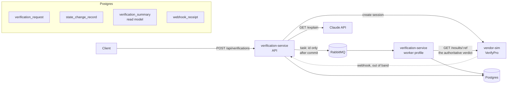

# kyc-verification-service

[](https://github.com/ShazAhmed10/kyc-verification-service/actions/workflows/ci.yml)

A small backend service demonstrating three patterns that show up whenever you integrate an
asynchronous third-party vendor: **async vendor integration with webhook + worker reconciliation**, a
**declarative state machine**, and **read-repair caching**.

Personal project inspired by KYC integration work, built with AI assistance. The domain and vendor
here are simulated: "VerifyPro" is fictional and runs as a container in this repo, so the whole thing
is self-contained.

---

## What it does

A client asks the service to verify someone. The service opens a session with VerifyPro and hands back
a token. The subject completes their checks with the vendor. The vendor calls a webhook to say it has
something. The service queues a reconciliation task; a worker picks it up, asks the vendor for the
actual verdict, and moves the verification to its final state.

The important design decision is in that last sentence. **The webhook carries no verdict.** It only
tells us it is worth asking. The outcome is always read from the vendor's result API. Everything else
follows from that:

- A forged or replayed webhook costs a wasted reconciliation, not a wrong decision.
- Running reconciliation twice produces the same answer, so at-least-once delivery is safe.
- If the webhook never arrives at all, a sweeper reconciles anyway and the request still resolves.

## Architecture



### The three patterns

**1. Async vendor integration.** `POST /api/verifications` → vendor session → webhook → queue → worker
→ result fetch → state update. The queue message contains **only the verification id**; the worker
rebuilds everything else from current database state on delivery. A message that sat in the queue, or is
being redelivered after a failure, is therefore evaluated against the request as it is *now* rather than
replaying a frozen snapshot. Costs one extra read per delivery; buys correctness under redelivery.

**2. Declarative state machine.** Every legal move is one row in
[`TransitionTable`](verification-service/src/main/java/dev/portfolio/verifyflow/statemachine/TransitionTable.java).
There is no `switch` on state anywhere and no state-machine library. The lookup key is
`(event, fromState)` and the target is *derived* — callers never supply it.

That key choice is what lets `RESULT_APPROVED` mean different things from different states:
`IN_REVIEW → VERIFIED` is the happy path, and `PENDING → VERIFIED` is the case where the callback never
arrived and reconciliation found the answer anyway. A `Map<Event, State>` cannot express that.
`TransitionRegistry` validates the table at startup and refuses to boot on a duplicate key, because the
failure mode of an ambiguous table is not an exception — it is the machine quietly picking one of two
answers.

| Event | From | To |
|---|---|---|
| `SESSION_ISSUED` | `PENDING` | `PENDING` (self-loop, recorded for audit) |
| `CALLBACK_RECEIVED` | `PENDING` | `IN_REVIEW` |
| `RESULT_APPROVED` | `PENDING` / `IN_REVIEW` | `VERIFIED` |
| `RESULT_DECLINED` | `PENDING` / `IN_REVIEW` | `REJECTED` |
| `RESULT_INCONCLUSIVE` | `IN_REVIEW` | `IN_REVIEW` |
| `EXPIRE` | `PENDING` / `IN_REVIEW` | `EXPIRED` |
| `OVERRIDE_APPROVE` | `IN_REVIEW` / `REJECTED` / `EXPIRED` | `VERIFIED` |
| `OVERRIDE_REJECT` | `IN_REVIEW` / `VERIFIED` / `EXPIRED` | `REJECTED` |

`GET /api/admin/state-machine` returns this from the running service, so the table above can be checked
against the code rather than trusted.

**3. Read-repair.** `verification_summary` is a denormalised projection with a `refreshed_at` stamp.
Reads serve it if fresh and rebuild it in place if not, so nothing is ever served stale and a projection
nobody reads is never rebuilt. A per-id lock collapses concurrent rebuilds of the same row. No
background refresher is needed for correctness.

### AI feature: `GET /api/verifications/{id}/explain`

Explains what happened to one request in plain English, and flags anything that looks wrong.

**Detection is deterministic; the model only narrates.**
[`StuckSignalCalculator`](verification-service/src/main/java/dev/portfolio/verifyflow/insight/StuckSignalCalculator.java)
computes the facts in plain Java — time in state, the service expectation, the peer-group median,
whether a callback ever arrived, how many reconciliations ran, whether the session expired. Those
signals plus the audit timeline go to Claude, which turns them into two paragraphs.

This split is deliberate. An LLM asked to do the arithmetic will occasionally get it wrong and you
cannot unit-test it. Computing signals in code makes the detection testable — the 11 tests in
`StuckSignalCalculatorTest` are only possible because no model is involved — and leaves the model doing
what it is actually good at.

The endpoint returns the signals and a deterministic summary **always**, and the narrative only when a
model is reachable. It works with no API key at all.

---

## Running it

```bash
git clone <this repo> && cd kyc-verification-service

# Optional - only the /explain narrative needs it. Everything else runs without.
cp .env.example .env && $EDITOR .env     # or: export ANTHROPIC_API_KEY=...

docker compose up --build                 # first build downloads Maven deps, ~2-3 min
```

Five containers: Postgres, RabbitMQ, the API (`:8080`), the worker (`:8081`), the vendor simulator
(`:9090`). RabbitMQ's management UI is on `:15672` (guest/guest) if you want to watch the queue.

### Try it

The simulator picks its behaviour from a prefix on the subject reference, so you can drive any scenario
without an admin API:

```bash
# Happy path - approved a couple of seconds later
curl -s -XPOST localhost:8080/api/verifications \
  -H 'Content-Type: application/json' -d '{"subjectRef":"alice-1"}'

# then, using the returned id:
curl -s localhost:8080/api/verifications/<id>          # summary, read-repaired
curl -s localhost:8080/api/verifications/<id>/history  # full audit trail
curl -s localhost:8080/api/verifications/<id>/explain   # signals + narrative
```

| Subject prefix | What the vendor does | What it demonstrates |
|---|---|---|
| *(anything)* | callback, then `APPROVED` | happy path |
| `decline-` | callback, then `DECLINED` | the other verdict |
| `flip-` | `INCONCLUSIVE` first, `APPROVED` after | a self-loop that keeps the request waiting |
| `silent-` | **no callback ever** | the sweeper reconciling a request nobody told us about |
| `flaky-` | result endpoint 503s twice | retry, then success |
| `slow-` | result endpoint sleeps past the read timeout | timeout → retry → dead-letter |
| `unknown-` | vendor has no such reference | unresolved, deliberately not settled |

`silent-` is the most interesting one: nothing arrives, and roughly two minutes later
(`EXPIRY_TTL=PT2M` in compose) the sweeper reconciles it and it resolves anyway.

To see de-duplication working, make the vendor resend a callback:
`curl -XPOST localhost:9090/admin/resend/<vendorRef>`.

### Tests

```bash
mvn test        # 43 tests, no Docker required
```

Weighted towards the two areas that decide correctness — the state machine (14) and reconciliation
under repeat delivery and failure (12) — plus the stuck signals (11) and read-repair (6). The
reconciliation tests use a *real* `TransitionEngine` rather than a mock, so they fail if the state
machine is wrong and not merely if the service forgets to call it.

---

## Design decisions & trade-offs

Written as trade-offs rather than features, because none of these is free.

**The worker is a queue consumer, not a managed function.** It runs the same artifact under a `worker`
Spring profile as its own container. This preserves what is worth demonstrating — at-least-once
delivery, retry with backoff, a real dead-letter queue, a genuine process boundary — and it is testable
without cloud infrastructure. What it does **not** demonstrate, and a real serverless deployment would:
independent scaling, and **credential isolation**, where the vendor secret lives with the function
rather than with the application. My version keeps that credential in the service's own config, which is
weaker. A LocalStack Lambda would show the boundary at the cost of much fiddlier retry semantics.

**Publish-after-commit is not a transactional outbox.** The queue publish happens in a
`@TransactionalEventListener(phase = AFTER_COMMIT)`. The database and the broker have no shared
transaction, so *something* must be able to fail. Publishing inline would mean a rolled-back transaction
could still emit a message, and the rest of the system would act on something that never happened.
Publishing after commit inverts that: the state change stands and the message can be lost, leaving a
request that is correct but unreconciled — which the expiry sweeper picks up. That is strictly the better
direction to fail in, but it is still a window. A true outbox (write the intent in the same transaction,
drain it with a poller) closes it, and is the first thing I would add for production.

**The webhook's shared secret is defence in depth, not the control that protects correctness.** There is
no HMAC over the body and no timestamp, so a captured call can be replayed; replay is absorbed by the
`webhook_receipt` unique constraint rather than prevented at the edge. This is only tolerable *because*
the endpoint carries no verdict. A real integration should sign the body and reject stale timestamps.
The comparison is constant-time anyway, since that costs nothing.

**Stuck-detection is absolute, with the peer comparison as context only.** This started out purely
relative — flag a request at 3× its cohort's median. A test caught the flaw: when the whole population
slows down, the median rises with it, a two-hour-old request among two-hour-old peers scores a ratio of
1.0, and nothing is ever flagged. Relative comparison goes blind precisely during a systemic stall. So
the gate is now an absolute service expectation, and the cohort ratio is reported alongside it because it
answers a different and genuinely useful question for whoever is on call: is this one request unusual, or
is everything equally bad?

**The read-repair stampede guard is in-process.** It collapses concurrent rebuilds within one instance,
not across instances. Two API containers can each rebuild the same row once. A distributed lock would fix
it and is not worth the dependency at this size — but it means the guard is a latency optimisation, not a
correctness mechanism.

**Read-repair trades even latency for freshness.** Nothing is served stale and no rebuild is wasted on
rows nobody reads, but the first reader after an invalidation pays for the rebuild. A scheduled refresher
inverts that: uniform read latency, a fixed staleness window, and wasted work on cold rows. For a
read-mostly projection where correctness matters more than p99 uniformity, repair-on-read is the better
trade.

**The vendor call at `start()` happens inside the transaction.** This keeps the request and its vendor
reference consistent — we never persist a request whose session we failed to open — at the cost of holding
a transaction open across a network call. At higher volume this should become create-then-attach, so the
transaction does not span the call.

**Effort is `LOW` on the LLM call.** The model writes prose from facts that are already computed; it is
not doing the analysis, so paying for deep reasoning would buy nothing. A direct consequence of keeping
detection deterministic.

**No server-side refusal fallbacks on the LLM call.** A refusal is treated as unavailability and the
endpoint falls back to the deterministic report. Production code should opt into fallbacks properly; I
did not want to guess at an API binding I had not verified.

**The admin endpoints are unauthenticated.** Indefensible in production — they would sit behind an
operator role. Stated rather than hidden.

---

## Stack

Java 17, Spring Boot 3.2, Postgres 16 (Flyway migrations, `ddl-auto=validate` so entity/schema drift is a
startup failure), RabbitMQ 3.13, the official Anthropic Java SDK, JUnit 5 + Mockito + AssertJ. No Lombok
— the code is meant to be read.

`Clock` is injected everywhere rather than calling `Instant.now()` inline, because expiry, stuck-detection
and the cohort comparison all read the clock, and tests assert on time instead of sleeping.
